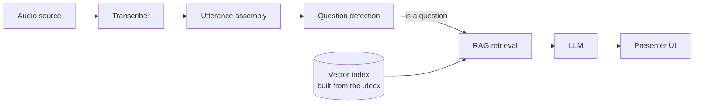

# AI Meeting Assistant

**Real-time retrieval-augmented answers for the person presenting a meeting.**
Upload a document beforehand; during the call the app transcribes the audio,
detects when someone asks a question, retrieves the relevant passage from your
document, and shows a concise, grounded suggested answer — privately, only to you.

<p>
  
  
  
  
  
  
</p>

---

## Why this project

Presenters and sales engineers constantly get asked questions whose answers are
already written down — in a spec, a briefing doc, a policy. This tool closes that
gap in real time without the presenter breaking eye contact to search a file.

It is built as a small, modular pipeline with clean seams, so each stage
(audio, transcription, question detection, retrieval, generation) can be swapped
or tested in isolation. The whole thing runs locally and can be driven end-to-end
**with no API keys and no microphone** for development and CI.

## Highlights

- **Streaming pipeline** — audio → transcript → question detection → RAG → LLM →
  private web UI, over a WebSocket, as the meeting happens.
- **Grounded answers with citations** — every suggestion names the document
  section it came from and is flagged when the document doesn't cover the question
  (no hallucinated confidence).
- **Provider-agnostic LLM layer** — one `LLMClient` interface; ships with Anthropic
  Claude, an offline stub, and a generic OpenAI-compatible client that works with
  free tiers (Groq, Gemini, OpenRouter, Cerebras) and local models (Ollama).
- **Pluggable audio** — a scripted transcript for tests, a recorded file, or live
  system-audio capture (WASAPI/CoreAudio loopback — no "Stereo Mix", works with
  Bluetooth), optionally mixed with the local microphone.
- **Local-first RAG** — `python-docx` parsing, sentence-transformer embeddings and
  a NumPy cosine index; no vector database, no cloud calls for retrieval.
- **Path to a real Zoom feature** — an in-client side panel is scaffolded behind
  the same interfaces; see the [roadmap](#roadmap).
- **Tested** — `pytest` suite covering parsing, chunking, retrieval, question
  detection, the audio mixer and the full pipeline (with fakes, no network).

## Demo

<!-- Add a short screen recording / screenshots before publishing:
     docs/demo.gif  — 20-30s: upload a .docx, start listening, a question turns into a card
     docs/presenter-view.png -->

> _Screenshots: `docs/` — presenter view with a live Q&A card and its source section._

## How it works



| Stage | Module | Notes |
|---|---|---|
| Audio → text | `backend/app/audio/*` | `Transcriber` / `AudioSource` interfaces. Implementations: scripted mock, recorded file, and live loopback (system audio, `+` mic, or a named device) transcribed with **faster-whisper**. |
| Utterance assembly | `backend/app/pipeline.py` | Buffers transcript chunks into turns; flushes on sentence punctuation, a silence gap, or a length cap. |
| Question detection | `backend/app/questions/detector.py` | Pure, rule-based: trailing `?`, leading WH-word / auxiliary / request verb, request phrases — also fires on imperatives ("tell me about…", "walk us through…"). |
| Retrieval (RAG) | `backend/app/rag/*` | `.docx` → titled sections → overlapping chunks → `all-MiniLM-L6-v2` vectors → in-memory cosine search, persisted under `backend/data/<doc_id>/`. A relevance floor means unrelated speech retrieves nothing. |
| Generation | `backend/app/llm/*` | `LLMClient` interface. A strict "use only these excerpts" prompt; the reply is parsed into answer text + a source section, or marked *not in document*. |
| Delivery | `backend/app/main.py` `/ws/presenter` | Server pushes `transcript` and `qa` events; the React client renders answer cards. |

## Architecture & design decisions

- **Interfaces at every seam.** `AudioSource`, `Transcriber`, `LLMClient` are
  small ABCs with factory functions. Adding a provider or an audio backend is a
  new class plus one registry line — no changes to the orchestrator
  (`MeetingSession`).
- **Runnable without secrets.** An `echo` LLM and a scripted transcriber let the
  entire pipeline — and the test suite — run offline and deterministically.
- **Grounding over fluency.** The retriever applies a similarity floor and the
  generator is instructed to refuse when the document is silent; the UI surfaces
  that state instead of hiding it.
- **Right-sized infrastructure.** One `.docx` at a time, an in-memory index
  persisted to disk, `asyncio` tasks instead of a queue/broker. The structure
  leaves room for multi-tenant/DB later without paying for it now.
- **Config, not code.** Every tunable (models, `TOP_K`, thresholds, chunk sizes,
  CORS, provider keys) is an environment variable resolved through one
  `pydantic-settings` module.

## Tech stack

| Area | Tools |
|---|---|
| Backend | Python 3.11+, FastAPI, Uvicorn, Pydantic / pydantic-settings, WebSockets |
| Speech / ML | faster-whisper, sentence-transformers, PyTorch, NumPy |
| Audio capture | sounddevice, soundcard (WASAPI/CoreAudio loopback), soundfile |
| LLM | Anthropic SDK; any OpenAI-compatible API (Groq / Gemini / OpenRouter / Cerebras / Ollama) via `httpx` |
| Frontend | React 18, TypeScript, Vite, Material UI, Redux Toolkit |
| Tooling | pytest, pytest-asyncio, ESLint/`tsc`, Vite build |

## Getting started

### Prerequisites

- Python **3.11+** (developed on 3.14)
- Node **18+** (developed on 24)
- Optional: an LLM key for real answers — a **free** one works (see
  [Free LLM key](#free-llm-key)). The `echo` provider needs none.

### Backend

```bash
python -m venv .venv
# Windows: .venv\Scripts\activate    |    macOS/Linux: source .venv/bin/activate
pip install -r backend/requirements.txt
cp backend/.env.example backend/.env
```

> First run downloads the embedding model (~90 MB) and, for the `file` / live
> audio sources, a faster-whisper model.

All backend commands run from `backend/`:

```bash
cd backend
python -m pytest                                   # run the test suite
python -m uvicorn app.main:app --reload --port 8000
```

PowerShell doesn't support `&&` or `VAR=value cmd`; set env vars first
(`$env:LLM_PROVIDER = "echo"`) and, if you run from the repo root, add
`--app-dir backend`.

### Frontend

```bash
cd frontend
npm install
npm run dev          # http://localhost:5173  (proxies /api and /ws to :8000)
```

### Try it (no keys, no mic)

1. Open <http://localhost:5173>.
2. Upload `backend/sample_data/sample_presentation.docx`.
3. Source = **Scripted transcript (demo)** → **Start listening**.

Answer cards appear as the scripted participants ask questions; statements
produce nothing; an off-document question is flagged *not in document*.

For a single-process deployment, `cd frontend && npm run build` then start the
backend — it serves the built UI at `/`.

## Free LLM key

`echo` gives no real answers and Claude is paid. Several providers have a genuine
free tier behind the same OpenAI-compatible protocol:

| Provider | Free key | Suggested model |
|---|---|---|
| Groq (fast) | <https://console.groq.com> | `openai/gpt-oss-20b` |
| Google Gemini | <https://aistudio.google.com/apikey> | `gemini-2.0-flash` |
| OpenRouter | <https://openrouter.ai/keys> | `meta-llama/llama-3.3-70b-instruct:free` |
| Cerebras | <https://cloud.cerebras.ai> | `llama-3.1-8b` |

```bash
# backend/.env
LLM_PROVIDER=groq
LLM_API_KEY=your_key_here
```

`python -m scripts.check_llm` makes one real call and prints the outcome (bad key,
wrong model, network, or OK) and, on a model error, the models your key can use.
A local model works too: `LLM_PROVIDER=openai`,
`LLM_BASE_URL=http://localhost:11434/v1` (Ollama).

## Live meeting audio

The `loopback` source captures live audio and transcribes it with Whisper. The
default **System audio** option is a WASAPI/CoreAudio loopback of your output
device — it hears the other participants, needs no "Stereo Mix" or virtual cable,
and works with Bluetooth. **System audio + your microphone** mixes in your own
voice as well.

```bash
cd backend
python -m scripts.check_audio        # 8s level meter — confirm audio is arriving
python -m scripts.list_audio_devices # list selectable capture options
```

In the UI: source = **Live meeting audio**, pick the device, **Start**.

## Configuration

Everything lives in `backend/app/config.py`, overridable via `backend/.env`
(see `backend/.env.example`). Selected keys:

| Variable | Default | Purpose |
|---|---|---|
| `LLM_PROVIDER` | `echo` | `echo`, `claude`, or a free provider (`groq` / `gemini` / `openrouter` / `cerebras` / `openai`) |
| `LLM_API_KEY` | — | key for the free / OpenAI-compatible providers |
| `LLM_MODEL` / `LLM_BASE_URL` | — | override model, or point `openai` at a local server |
| `WHISPER_MODEL` | `base.en` | faster-whisper model |
| `EMBED_MODEL` | `all-MiniLM-L6-v2` | sentence-transformers model |
| `TOP_K` / `MIN_SCORE` | `4` / `0.15` | chunks retrieved per question / relevance floor |
| `CORS_ORIGINS` | `http://localhost:5173` | allowed browser origins |

> `backend/.env` is git-ignored — keep your keys out of version control.

## API

| Method | Path | Purpose |
|---|---|---|
| `POST` | `/api/documents` | ingest a `.docx` → `{ doc_id, sections, chunks }` |
| `POST` | `/api/session/start` | `{ source: "mock" \| "file" \| "loopback", path? }` |
| `POST` | `/api/session/stop` | stop the pipeline |
| `GET` | `/api/audio/devices` | list capture options for the loopback source |
| `WS` | `/ws/presenter` | receive `transcript` and `qa` events |

## Testing

```bash
cd backend && python -m pytest        # unit + integration, no network
cd frontend && npm run build          # type-checks the whole app
```

Coverage spans docx parsing, section-aware chunking, the cosine vector store,
retrieval thresholds, question detection (positive/negative tables), the audio
mixer, the OpenAI-compatible client (mocked HTTP), and a full
`MeetingSession` run driven by a scripted transcript.

## Project structure

```
backend/
  app/
    audio/        AudioSource / Transcriber interfaces + mock, file, loopback, mixer
    questions/    rule-based question detection
    rag/          docx loading, chunking, embeddings, vector store, retriever
    llm/          LLMClient interface + Claude / OpenAI-compatible / echo + factory
    pipeline.py   MeetingSession — the orchestrator
    runtime.py    process state: presenter hub + active session
    main.py       FastAPI app: REST + WebSocket
  scripts/        ingest, list_audio_devices, check_audio, check_llm
  tests/          pytest suite
frontend/
  src/
    app/          Redux store + WebSocket middleware
    features/     document / session / qa / transcript slices + components
    components/   shared UI (step header, live indicator)
```

## Roadmap

- **Now** — local pipeline, live system-audio capture, free/paid LLM providers,
  redesigned presenter UI.
- **Next** — Zoom App side panel (in-client, private): a development-mode Zoom
  Marketplace app served over a tunnel, reusing the existing UI and pipeline;
  security-header middleware is already in place.
- **Later** — Zoom Realtime Media Streams for server-side audio (needs a paid Zoom
  plan), per-meeting sessions, persistence, and Marketplace submission.

## License

MIT — see [`LICENSE`](LICENSE).

## Author

**Amruta** — [github.com/amruuta](https://github.com/amruuta)
